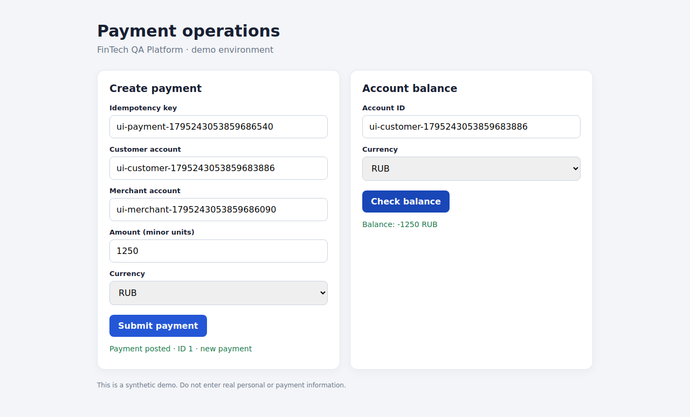

# Artem Kalinin | Application Support · QA Automation · Data Analysis · Web Development

Hands-on technical portfolio with reproducible projects in incident investigation, REST API testing, automated QA, SQL analysis, and frontend development.

**[Open the portfolio website](https://blvxx.github.io/portfolio/)** · **[Freelance web-development portfolio](https://blvxx.github.io/frontend-portfolio/)** · **[GitHub profile](https://github.com/blvxx)**

## Start here

| Focus | Best project | What it demonstrates |
|---|---|---|
| Application / Technical Support | [Incident Investigation Lab](./incident-lab/) | Incident triage, log analysis, webhook diagnostics, SQL reconciliation, RCA, recovery runbooks |
| QA Engineering | [FinTech QA Engineering Platform](./fintech-qa-platform/) | API and integration testing, database checks, idempotency, browser E2E, CI and observability |
| API Automation | [Python / pytest API Automation](./api-automation/) | Reusable HTTP client, CRUD contracts, JSON Schema, negative tests, mocks and Postman |
| Data Analysis | [E-commerce SQL + Python Analysis](./data-analytics/) | KPI calculation, SQL reporting, segmentation, pandas, validation and repeatable exports |
| Frontend Development | [Frontend Portfolio](https://github.com/blvxx/frontend-portfolio) | Responsive business websites and interactive UI concepts |

## Featured projects

### 1. Incident Investigation Lab — Payment Webhook Failure

A simulated support incident: a payment provider reports successful payments, while some storefront orders remain in `pending_payment`.

- Investigation timeline, synthetic application logs and impact assessment.
- Python utilities to classify log patterns and inspect incidents.
- SQL diagnostics for duplicate payment IDs and order/payment state mismatches.
- Webhook troubleshooting, Root Cause Analysis (5 Whys), recovery and reconciliation runbooks.
- Unified command-line toolkit that produces consolidated incident findings.

**Skills:** Application Support · Incident Management · HTTP / Webhooks · Python · SQL · Log Analysis · RCA · Runbooks

[Open the case study](./incident-lab/)

### 2. FinTech QA Engineering Platform

An end-to-end QA sandbox for a fictional payment product with separate Payment and Ledger services.

- REST API, service-integration and negative testing.
- Idempotency checks and debit/credit balance invariants.
- PostgreSQL persistence and Docker Compose environment.
- Playwright browser tests for payment submission and balance verification.
- Postman collection, test strategy, test cases, risk analysis and Allure reporting.
- GitHub Actions CI plus Prometheus / Grafana observability.

**Stack:** Python · FastAPI · pytest · Playwright · SQLAlchemy · PostgreSQL · Docker · Postman · Allure · GitHub Actions

[Open project and screenshots](./fintech-qa-platform/)

### 3. API Automation — Python / pytest

A focused REST API automation suite for the JSONPlaceholder Posts resource.

- GET, POST, PUT, PATCH and DELETE contract checks.
- Positive, negative and parametrized test scenarios.
- Reusable `requests` client with explicit timeouts.
- JSON Schema validation and isolated unit tests with mocked HTTP sessions.
- Postman collection with response assertions and GitHub Actions CI.

**Stack:** Python · pytest · requests · jsonschema · Allure · Postman · Ruff

[Open project](./api-automation/)

### 4. SQL + Python Data Analytics — E-commerce Sales

An end-to-end analysis of a transparent synthetic dataset containing 360 orders.

- SQL schema and queries for monthly KPIs, customer groups and segments.
- pandas pipeline for revenue, orders and customer metrics.
- Regional, product-category and sales-channel breakdowns.
- Input validation, business-rule tests and reproducible CSV / JSON exports.

**Stack:** SQL · PostgreSQL · Python · pandas · pytest

[Open project and findings](./data-analytics/)

## Additional practical work

### [Fintech Support & QA Lab](./fintech-support-qa-lab/)

A local payment API sandbox covering payment lifecycle checks, HMAC-SHA256 webhook validation, idempotent event handling, SQL investigation, synthetic log analysis, Postman and Docker Compose.

### [Todo Test — Playwright UI Automation](https://github.com/blvxx/todo-test)

A small browser-based task tracker used as an automation target. Includes 17 manual test cases, 8 authored Playwright scenarios and a GitHub Actions workflow.

[Latest Playwright workflow run](https://github.com/blvxx/todo-test/actions/runs/44837577569) — successful on 20 November 2026.

### [Frontend Portfolio — Website Concepts](https://github.com/blvxx/frontend-portfolio)

Four responsive concepts for different business types: NOIR COFFEE, FRAME STUDIO, IRON DISTRICT and VÉRA SKIN. These demonstrate frontend implementation and visual presentation, not paid client deliveries.

## Technologies

**Support & troubleshooting:** HTTP · REST APIs · Webhooks · SQL · PostgreSQL · Logs · Incident Triage · RCA · Runbooks

**QA & automation:** Python · pytest · requests · Playwright · Postman · JSON Schema · Allure · Ruff

**Development & delivery:** FastAPI · JavaScript · HTML5 · CSS3 · Docker · GitHub Actions · Prometheus · Grafana

**Analytics:** SQL · Python · pandas · CSV / JSON reporting · KPI analysis

## How to evaluate the work

1. Start with the [Incident Investigation Lab](./incident-lab/) for a complete support-style investigation.
2. Open the [FinTech QA Platform](./fintech-qa-platform/) for architecture, test evidence and screenshots.
3. Review the [API Automation](./api-automation/) and [Data Analytics](./data-analytics/) READMEs for setup and reproducible commands.

## Transparency

- Payment systems and incidents in this portfolio are simulated.
- Datasets, logs, orders and payment records are synthetic.
- These repositories are independent portfolio projects, not claims of production access or commercial client delivery.
- Workflow badges and linked Actions runs show the actual CI status; a configured workflow alone is not proof of a passing run.

## Maintainer

**Artem Kalinin** · [GitHub](https://github.com/blvxx)
